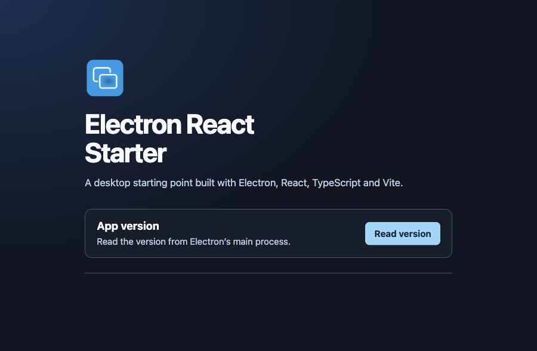

# Electron React Starter

A small desktop app template with Electron, React, TypeScript, and Vite. The example shows how a React button can read the app version from Electron's main process through a typed preload API.



## Get started

Install Node.js 24 LTS with npm, then clone the repository and start the app:

```sh
git clone https://github.com/maxstue/vite-reactts-electron-starter.git
cd vite-reactts-electron-starter
npm ci
npm run dev
```

The first run may download the Electron binary. React changes use fast refresh, main-process changes restart Electron, and preload changes reload the window.

npm and `package-lock.json` are the reference for CI. To switch a project created from this template to Yarn or pnpm, use that manager to install dependencies, keep its lockfile, and update the install and cache steps in CI. Check packaging again after switching managers.

## Project layout

| Path                   | Purpose                                                                          |
| ---------------------- | -------------------------------------------------------------------------------- |
| `src/main`             | Electron lifecycle, native window, IPC handlers, and the production app protocol |
| `src/preload`          | The allowlisted methods available on `window.desktop`                            |
| `src/renderer`         | React UI, styling, and the global type for `window.desktop`                      |
| `src/shared`           | IPC channel and the types shared across the boundary                             |
| `resources/icon.png`   | The app icon used by the demo and electron-builder                               |
| `electron-builder.yml` | Application ID and distribution targets                                          |

Run `npm run lint` for Oxlint, `npm run format` to apply Oxfmt, and `npm run typecheck` for TypeScript. CI also runs `npm run format:check`.

When adding an IPC method, give the preload wrapper a specific purpose and validate its sender and any arguments in the main process. The production renderer loads from `app://renderer` under a restrictive content security policy.

### Environment variables

If your app needs public build-time settings, add a local `.env` in the repository root and use `import.meta.env.RENDERER_VITE_*` in the renderer. These values are bundled with the app and are readable by anyone who installs it. Read runtime environment variables with `process.env` in the main process. Electron apps distributed to users cannot keep embedded secrets private.

## Build and package

| Command                 | Result                                                                                          |
| ----------------------- | ----------------------------------------------------------------------------------------------- |
| `npm run build`         | Type-check and compile the app into `out/`                                                      |
| `npm start`             | Run an existing production build locally                                                        |
| `npm run pack`          | Build an unpacked desktop app in `dist/`                                                        |
| `npm run test:packaged` | Start the unpacked app in a separate working directory and verify the renderer, assets, and IPC |
| `npm run dist`          | Build a local DMG, NSIS installer, or AppImage on macOS, Windows, or Linux                      |

Run packaging on the target operating system. Linux needs a graphical session for the smoke check. On headless CI, use `xvfb-run -a npm run test:packaged`. For public distribution, configure code signing and macOS notarization for your own app.

Before shipping your own app, update the name, version, and repository in `package.json`, the product name and app ID in `electron-builder.yml`, the demo UI and window title in `src/`, and `resources/icon.png`. Update the example-specific smoke assertions as you replace the demo.

## License

[MIT](LICENSE.md)
